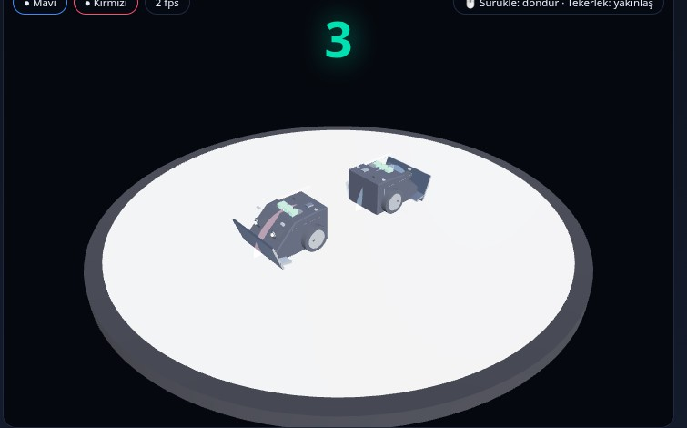

# Mini Sumo 3D Simülatör

Arduino Nano firmware'lerini **gerçek AVR emülasyonu** ile çalıştıran, **PyBullet 3D fizik**
motoruna sahip, tarayıcı tabanlı mini sumo robot simülatörü.



## Özellikler

| Özellik | Açıklama |
|---|---|
| 🎮 **Gerçek firmware** | `.ino` kodu `arduino-cli` ile derlenir, `simavr` ile gerçek ATmega328P olarak çalışır |
| 🧊 **Gerçekçi 3B robot (WebGL/GPU)** | Gerçek bir mini sumo robotu (Senju) esinli model: siyah gövde, çelik ön bıçak, açık elektronik, jantlı tekerlekler; PBR + gölge + ortam ışığı |
| 🧪 **Eğitim / Test modu** | Motor testi + sensör testi: manuel sürüş, canlı QTR/E3Z, hedef yerleştirme |
| ⚖️ **Ayarlanabilir ağırlık** | Her robot için panelden 100–500 g |
| 🔘 **DIP switch** | **Her robotta 3 adet** 2-konumlu DIP; panelden robot başına ayrı ayarlanır, firmware `digitalRead` ile okur |
| 🤖 **İki robot yarışı** | İki öğrenci firmware'i aynı anda, hakem + kazanan tespiti |
| 🌐 **Çok istemcili oda** | Hakem bir **oda kodu** oluşturur; iki öğrenci **farklı bilgisayarlardan** mavi/kırmızı tarafa katılır, herkes maçı kendi ekranında canlı izler |
| 🔐 **Rol ve DIP kilidi** | Her oyuncu yalnızca **kendi** kodunu/DIP'ini yönetir; DIP switch'ler tur sırasında kilitlidir, **turlar arasında** açılır |
| 💻 **Tarayıcı paneli** | Canlı 3B görüntü, telemetri, kod editörü, firmware yükleme |
| 🚀 **GPU/çok çekirdek** | RTX 4090 + 32 çekirdek; konteyner makinenin gücünü kullanır |

## Donanım / Pin Haritası

| Bileşen | Pin | Tip |
|---|---|---|
| QTR-1A sol / sağ (alt yansıma) | `A0` / `A1` | Analog 0–1023 |
| E3Z-D81 sol / sağ (ön mesafe) | `D2` / `D3` | Dijital (INT0/INT1) |
| Motor sol | PWM `D9` + yön `D7`,`D8` | H-köprü |
| Motor sağ | PWM `D10` + yön `D4`,`D12` | H-köprü |
| Motor enable | `D6` | Dijital |
| DIP switch 1/2/3 (**her robotta 3 adet**) | `A2` / `A3` / `A4` | `INPUT_PULLUP` (kapalı = aktif) |
| Pil ölçüm (3S LiPo) | `A5` | Analog |
| Başlat butonu | `D11` | Dijital |

Diğer: **Motor** jSumo Force Up 6V 250 RPM ×2 · **Pil** 3S LiPo 11.1 V · **Ağırlık** ≤ 500 g.

## Hızlı Başlangıç

```bash
cd ~/MiniSumoSimulator
docker compose up -d --build
# Tarayıcıda: http://localhost:7101   (7012 / 7013 da aynı paneli açar)
```

Kapatmak için:

```bash
docker compose down
```

## Kullanım

Sayfa açıldığında **lobi** ekranı gelir. Üç rol vardır:

- **🎓 Hakem / Öğretmen** — odayı oluşturur, maçı başlatır/durdurur/sıfırlar.
- **🟦🟥 Oyuncu** — oda koduyla kendi tarafına katılır, kendi kodunu ve DIP'ini yönetir.
- **👁 İzleyici** — oda koduna gerek olmadan maçı salt-okunur izler.

> Tek başınıza test etmek için **🎓 Oda Oluştur** deyip aynı odaya ikinci bir
> pencereden farklı tarafı seçerek katılabilirsiniz. Oda oluşturulmadan önce panel
> **açık mod**da (tek kullanıcı) çalışır.

### 🌐 Çok istemcili maç (oda akışı)

1. **Hakem** lobide adını yazıp **🎓 Oda Oluştur**'a basar. Üst çubukta 6 karakterli
   **oda kodu** (örn. `K7M2PQ`) görünür.
2. Her **öğrenci** bu oda kodunu girer, adını yazar, **🟦 Mavi** / **🟥 Kırmızı**
   tarafı seçip **🚀 Odaya Katıl**'a basar. URL'ye `?room=KOD` eklenirse kod
   otomatik dolar.
3. Her oyuncu **Kod Editörü**'ne kendi firmware'ini yazar ve **📤 Kodu Gönder**'e
   basar, ardından **✅ Hazırım**'ı işaretler. (Kod yazarken otomatik olarak da
   sunucuya gönderilir.)
4. **Hakem** **▶ Maçı Başlat**'a basar. Maç, oyuncuların **son gönderdiği kodlarla**
   başlar (oyuncu kodu yoksa örnek firmware kullanılır).
5. Herkes aynı maçı kendi ekranında **canlı 3B** izler. Oyuncular yalnızca **kendi**
   DIP switch'lerini ve ağırlıklarını değiştirebilir; diğer robotunkiler kilitlidir.

### 🔐 DIP switch kilidi

| Aşama | DIP değiştirilebilir mi? |
|---|---|
| `idle`, `finished`, test/eğitim modu | ✅ Açık |
| **Tur arası** (`break`, varsayılan 12 sn) | ✅ Açık — taktik değiştirme penceresi |
| Geri sayım (`countdown`) | 🔒 Kilitli |
| Tur sürerken (`running`) | 🔒 Kilitli |

Bir tur bitince maç **`break`** durumuna geçer; panelde **tur arası afişi** ve geri
sayım görünür, bu sırada oyuncular DIP'lerini değiştirebilir. Süre dolunca yeni tur
5 sn geri sayımla başlar ve DIP yeniden kilitlenir. Kilitli DIP'e tıklandığında
sunucu **HTTP 409** döner ve panel uyarı gösterir.

---

Panel iki modda çalışır (üstteki **🏁 Maç / 🧪 Eğitim / Test** düğmesi):

### 🧪 Eğitim / Test modu

Öğrencilerin robotla birebir çalıştığı ortam. İki alt çalışma biçimi vardır:

- **🕹️ Manuel Mod:** İleri / Geri / Sol / Sağ / Yerinde dön / Kare dön / Daire
  düğmeleri veya iki PWM kaydırıcısı (`-255..255`) ile robotu elle sür.
- **⚡ Kod Testi:** Aşağıdaki **Kod Editörü**'ne firmware'ini yaz → **Derle & Test Et**.
  Tek test robotu yazdığın koda göre çalışır. Robotu/hedefi konumlandırıp sensörleri
  ve davranışı canlı izle.

**Sensör Testi araçları:** Robotu X / Y / yaw kaydırıcılarıyla konumlandır
(**Merkez**, **Kenara** kısayolları). QTR sensörlerinin BEYAZ/**KENAR** geçişini ve
E3Z sensörlerinin **hedefi** görüp görmediğini canlı izle. Kırmızı hedefi
**Öne koy / Sağa / Kaldır** ile yerleştir.

> **DIP switch'ler her robot için ayrıdır** (soldaki kartta 🟦 Mavi / 🟥 Kırmızı grupları).
> Kod testi veya maç sırasında tıklayarak robotun `digitalRead` ile okuduğu modu
> anında değiştir. Test/eğitim modunda tek (mavi) test robotu vardır; her iki oyuncu
> da bu robotun DIP'ini kullanır.

### 🏁 Maç modu

1. **Kod Editörü**'nde Robot 1 ve Robot 2 sekmelerine kodu yaz (oyuncular yalnızca
   kendi sekmelerini görür; hakem ikisini de görür).
2. **⬆ Yükle** ile `.ino` yükle veya **📂 Aç** ile kayıtlı firmware'i getir.
3. **🔍 Derle** ile derleme kontrolü yap.
4. **▶ Maçı Başlat** ile maçı başlat (5 sn geri sayım; robotlar **sırt sırta** başlar).
   Maç **3 tur** oynanır, **2 turu kazanan** maçı alır (best-of-3). Üst çubukta
   canlı skor ve tur numarası görünür; her turda robotlar yeniden sırt sırta dizilir,
   aralarda **tur arası** penceresi açılır.
5. **DIP switch**'lere tıkla → firmware anında yeni moda geçer (tur arasında).
6. **Ağırlık** kaydırıcıları ile robot kütlesini değiştir.

Her robot kendi `.ino` firmware'i ile çalışır. İkisi de aynı kodu farklı DIP
konumlarıyla farklı stratejiler uygulayabilir.

> **Sahne:** Fare ile sürükleyerek döndür, tekerlekle yakınlaştır (OrbitControls).

## Mimari

```
 .ino kaynağı
     │  arduino-cli compile
     ▼
  .elf  ──►  avr_harness (libsimavr, gerçek ATmega328P @16 MHz)
     ▲                    │  ADC (QTR), GPIO (E3Z/DIP)  →  AVR
     │                    │  OCR1A/OCR1B (PWM), PORT  ←  AVR
     └────────────┬───────┘
                  ▼
        simulation engine (PyBullet 3D, Ø77 cm dohyo)
                  │  sensör hesabı, motor kuvveti, render (JPEG)
                  ▼
        FastAPI + WebSocket/HTTP  ──►  tarayıcı paneli
```

Köprü protokolü (`bridge/avr_harness.c` başlığında ayrıntılı):
- Python→AVR: `qtr_left, qtr_right, vbat, e3z_l, e3z_r, dip, btn` (12 bayt)
- AVR→Python: `pwm_left, dir_left, pwm_right, dir_right, enable` (8 bayt)

## Proje Yapısı

```
MiniSumoSimulator/
├── docker/Dockerfile      # CUDA + simavr + arduino-cli + pybullet
├── docker-compose.yml     # GPU, port 7101/7012/7013
├── bridge/
│   ├── avr_harness.c      # libsimavr AVR köprüsü
│   └── firmware.py        # .ino derleme + AVR süreç yönetimi
├── sim/
│   ├── sim_engine.py      # PyBullet 3D dünya + maç motoru + render
│   └── urdf/mini_sumo_bot.urdf
├── panel/
│   ├── main.py            # FastAPI + REST (rol/oda yetkilendirme)
│   ├── room.py            # oda/oyuncu yönetimi (token, hazır, kod)
│   ├── index.html         # WebGL (Three.js) arayüz + kod editörü + lobi
│   └── static/            # three.min.js, OrbitControls.js (yerel)
├── firmware/              # örnek .ino dosyaları
├── config/robot_config.yaml
└── tests/                 # testler (smoke_test.py)
```

## API Uçları

| Metot | Yol | Açıklama |
|---|---|---|
| GET | `/api/room` | Oda durumu, oyuncular, rolünüz (token ile) |
| POST | `/api/room/create` | `{name}` — hakem odayı oluşturur, oda kodu + token döner |
| POST | `/api/room/join` | `{code, side:"blue"\|"red", name}` — odaya katıl, token al |
| POST | `/api/room/leave` | Odadan ayrıl (hakem ayrılırsa oda kapanır) |
| POST | `/api/player/ready` | `{ready}` — oyuncu hazır durumunu değiştirir |
| GET/POST | `/api/player/code` | Oyuncunun kodunu al / gönder (hakem `robot` ile seçer) |
| GET | `/api/state` | Maç durumu + robot telemetrisi |
| GET | `/api/frame.jpg` | Anlık 3B render karesi |
| POST | `/api/start` | `{code1, code2, duration, break_duration}` ile maç başlat (hakem; kodlar verilmezse oyuncu kodları kullanılır) |
| POST | `/api/stop` / `/api/reset` | Durdur / sıfırla (hakem) |
| POST | `/api/weight` | `{mass_g, robot}` ağırlık ayarla |
| POST | `/api/dip` | `{switches:[0/1,0/1,0/1], robot:0\|1}` DIP ayarla; tur sırasında **409** kilitli |
| POST | `/api/test/start` | Eğitim/test modunu başlat (tek robot, manuel) |
| POST | `/api/test/run` | `{code}` eğitim modunda tek robotu firmware ile çalıştır |
| POST | `/api/test/motor` | `{left,right}` manuel motor PWM (-1023..1023) |
| POST | `/api/test/place` | `{x,y,yaw}` robotu yerleştir (sensör testi) |
| POST | `/api/test/target` | `{x,y}` E3Z hedef nesnesini yerleştir |
| POST | `/api/compile` | `{code}` derleme kontrolü |
| GET/POST | `/api/firmware` | Firmware listele / kaydet |
| POST | `/api/upload` | `.ino` yükle |

## Notlar

- PyBullet fiziği CPU tabanlıdır; **3B görünüm WebGL (Three.js) ile tarayıcıda
  GPU'da** render edilir (RTX 4090). Sunucu tarafındaki PyBullet render'ı yalnızca
  yedek/`/api/frame.jpg` içindir.
- Motor modeli (tork/hız/gerilim) tahmini değerlerle kalibre edilmiştir; gerçek
  robot ölçümleriyle `sim/sim_engine.py` sabitleri güncellenebilir.
- Robot 2 tekerlek + kızak (3-nokta temas) ile modellenmiştir; resmi dohyo Ø77 cm.
- 3B robot modeli gerçek bir mini sumo robotundan (Senju) esinlenmiştir: siyah mat
  gövde, öne uzanan çelik bıçak, üstte açık PCB elektroniği, gümüş jantlı tekerlekler.
  Takım rengi LED/aksan ve zemin ışık halkasıyla iki robot ayırt edilir.

## Lisans

MIT — eğitim amaçlı serbest kullanım.
